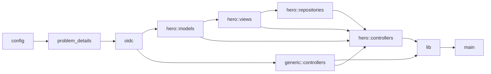
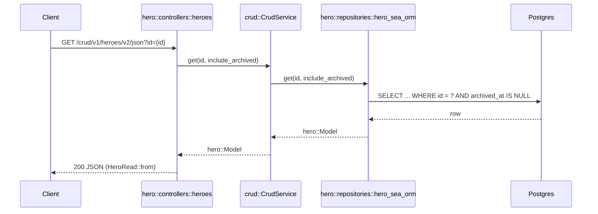

# src/

The axum application, laid out as an MVC-ish split across submodules,
each with its own `README.md`:

- `generic/` — what stays of the resource-agnostic layer in the app:
  `generic/controllers/` (`audit`, `mock` and their accessor traits),
  which need the app's configuration and authentication. The rest of the
  generic CRUD layer — models, views, repositories, `CrudService`, query
  parsing, bulk/stats/event helpers, the event bus — is the
  `craftainer-crud` crate, and the health checks, `/health` router and
  logging setup are the `craftainer-observability` crate
  (`docs/adrs/0020`). See "Generic vs. Hero-specific split" below.
- `hero/` — this template's worked CRUD example, built on the crates:
  `hero/models/`, `hero/views/`, `hero/repositories/`,
  `hero/controllers/` (including the concrete `AppState` every router is
  instantiated with). See "Generic vs. Hero-specific split" below.
- `oidc/` — provider-agnostic OIDC bearer-token validation plus
  Keycloak client-role RBAC.
- `migration/` — SeaORM migrations, applied automatically at startup.

`config.rs`/`db.rs`/`lib.rs`/`main.rs`/`problem_details.rs`/
`rate_limit.rs`/`http_headers.rs` stay flat, outside any
submodule — each has no resource-specific code and no state of its own
beyond what it's explicitly passed or reads from `config::Settings`.

- `config.rs` — settings, read from environment variables only; see
  "Configuration" and "MODE" below.
- `db.rs` — the Postgres pool: `connect_options` builds sea-orm's
  `ConnectOptions` from `config::DbSettings`, `connect` opens it; see
  "Database pool" below.
- `lib.rs` — the crate's library target: every module declaration plus
  the wiring (`build_state`, `build_state_with_db`, `connect_database`,
  `build_router`, `build_event_bus`, `build_health_registry`,
  `run_migrations`). See "Library and binary"
  below.
- `main.rs` — process entry point, deliberately thin: it installs
  logging (`craftainer_observability::logs`, keeping the guard to the end
  so the OTLP export is flushed), reads settings and calls `lib.rs`'s
  wiring; see "Structured logging" below.
- `problem_details.rs` — the single `AppError` type and its RFC 9457
  `IntoResponse` impl; see "RFC 9457 error responses" below.
- `rate_limit.rs` — `RateLimiter`, the Redis-backed (in-memory under
  `Mode::Mock`) per-caller rate limiter checked inline by Hero's
  create/update/delete handlers and `POST /mock/token`; see
  `docs/adrs/0011`.
- `http_headers.rs` — `Sunset`, an `IntoResponseParts` type a handler
  combines into its return value to attach RFC 8594 `Sunset`/
  `Deprecation`/`Link` headers (`docs/adrs/0012`), applied by every
  route in `hero::controllers::heroes_v1`/`heroes_v1_xml` (`NFR-0026`).

## Library and binary

This package builds both a `[lib]` (`lib.rs`, crate name
`template_axum`) and a `[[bin]]` (`main.rs`). The split exists so
`tests/`' integration tier can link against the crate's public API and
build the *same* router the binary serves, rather than a test-only
lookalike — Cargo integration tests cannot reach into a bin-only crate
at all. See `docs/adrs/0016` and `tests/README.md`.

Practical consequence: everything a test or the binary needs is `pub`
from `lib.rs`, and `main.rs` refers to it as `template_axum::...`, not
`crate::...`.

## CRUD event stream

`GET /crud/v1/heroes/v2/json/events` is a Server-Sent Events stream of
Hero create/update/delete activity (FR-0030). The resource-agnostic half
(subscriber-id resolution, frame shape, the publish helper) is
`craftainer_crud::controllers::crud_events`; the transport is
`craftainer_crud::events` (feature `mqtt` for the broker-backed bus).

The delivery guarantee is narrow and deliberate: a subscriber that
reconnects with the `subscriber_id` the server issued it gets everything
published while it was away, because that id (a server-minted capability,
not a client-chosen name) is part of the client id of a persistent,
QoS-1 MQTT session. A client that discards it, or sends one the server did
not mint, gets a new id and no replay, silently. The default minting secret
is random per process, so an id does not resume across a restart or on
another replica (`docs/adrs/0020`). `Mode::Mock` has no broker and no
replay at all. `docs/adrs/0016`, `docs/nfrs/NFR-0029` and the crate's
`events` module doc all state this; don't paraphrase it into something
broader.

A mutating handler announces its own event inline (`crud_events::
publish`) the way it checks its own rate limit — `CrudService` stays free
of infrastructure concerns (NFR-0004). Publishing never fails the request
that triggered it.

## Generic vs. Hero-specific split

The generic, resource-agnostic half of the Model/View/Repository/
Controller layers is the `craftainer-crud` crate (`docs/adrs/0020`, and
that crate's own ADR 0002), the health/logging half is
`craftainer-observability`. What remains in the app:

- `generic::controllers` — the routers that need the app's configuration
  and authentication (`audit`, `mock`). A router there that needs some
  piece of shared state declares its own narrow accessor trait
  (`HasSettings`/`HasRateLimiter`, mirroring `oidc::HasOidcVerifier`'s
  existing pattern) rather than depending on the concrete, Hero-bearing
  `AppState` — see `generic/controllers/README.md`. (The `/health` router's
  `HasHealthRegistry` is the crate's, `craftainer_observability::health::
  router`.)
- `hero::models`/`hero::views`/`hero::repositories`/`hero::controllers`
  — this template's worked CRUD example, built on top of the crates.
  `hero::controllers::AppState` is the one concrete state every router
  (Hero's own, `generic::controllers`' and the health router) is
  instantiated with — see that package's own module doc for why this app's
  one resource-specific dependency (`hero_crud`) lives there rather than
  somewhere purely generic.

`generic::*` never imports `hero::*` — enforced automatically by
`.github/scripts/check_layering.py` (the `check-layering` prek hook,
`docs/adrs/0009`'s "2026-09 update"), not just by convention. A new
resource adds its own sibling packages (`crate::<resource>::models` etc,
mirroring `hero::*`), implementing `craftainer_crud::repositories::
Repository` the same way Hero does.

## Layering

Import order between all of the above is strict and one-directional —
lower layers never import from higher ones: `config` → `problem_details`
→ `oidc` → `hero::models` → `hero::views` → `hero::repositories` →
`generic::controllers`/`hero::controllers` → `lib`/`main`, with
`rate_limit` and `http_headers` flat alongside. `.github/scripts/
check_layering.py` (backing the `check-layering` prek hook) checks this
automatically on every commit — see `docs/adrs/0009-strict-module-
layering-by-convention-and-visibility.md`'s "2026-09 update" for why a
small custom script rather than `cargo-modules` or a per-layer crate
split. Each module's own doc comment remains the reference for *why* its
position in the order is what it is. Imports of the two crates are
`craftainer_crud::`/`craftainer_observability::` paths, outside what the
script checks.

`db` is a leaf off `config` (it imports only `config`; only `lib`/`main`
import it).

An arrow means "may import from" — each module may depend on anything
upstream of it in this graph, never anything downstream.

## Configuration

No application `.env` file: `config.rs` reads settings from the process
environment only. `Settings::from_env` composes `DATABASE_URL` from the
individual `POSTGRES_*` pieces (unless `DATABASE_URL` is set directly),
and reads `RUSTFS_ACCESS_KEY`/`RUSTFS_SECRET_KEY` (falling back to
`S3_ACCESS_KEY`/`S3_SECRET_KEY`) the same way `config.py` does in the
reference implementation. `Mode::Production` additionally refuses to
construct `Settings` at all if a credential is left at its local
default, a connection scheme is plaintext, `POSTGRES_SSLMODE` is not an
encrypting mode, or `OIDC_AUDIENCE` is unset
— see `src/config.rs`'s own doc comments and its test suite.

## Database pool

`db::connect_options` turns `config::DbSettings` into sea-orm's
`ConnectOptions`; a setting is passed on only when its variable is set, so
an unconfigured process keeps sea-orm/sqlx's defaults. `docs/adrs/0022` and
`docs/nfrs/NFR-0031` give the reasoning; the variables are:

| Variable | Default | Effect |
| --- | --- | --- |
| `DB_POOL_SIZE` | unset (sqlx: 10) | Maximum pool connections, integer >= 1. Budget replicas x this against Postgres's `max_connections`. |
| `DB_POOL_MIN_SIZE` | unset (sqlx: 0) | Connections kept open while idle, integer >= 1, at most `DB_POOL_SIZE`. |
| `DB_POOL_RECYCLE` | unset (sqlx: 30 min) | Seconds before a connection is replaced, integer >= 1. |
| `DB_POOL_IDLE_TIMEOUT` | unset (sqlx: 10 min) | Seconds an unused connection may idle, integer >= 1. |
| `DB_CONNECT_TIMEOUT` | unset (sqlx: 30 s) | Seconds a caller waits for a connection, covering a free slot and opening a new one (sea-orm has one timeout for both); integer >= 1. |
| `POSTGRES_SSLMODE` | unset | `disable`, `allow`, `prefer`, `require`, `verify-ca` or `verify-full`; overrides a `sslmode` in `DATABASE_URL`. `Mode::Production` requires `require`, `verify-ca` or `verify-full`. |
| `RUN_MIGRATIONS_ON_STARTUP` | `true` | `false` skips the startup migration (see "Migrations"). |

A value that does not parse, or is below 1, fails `Settings::from_env`
rather than being ignored. There is no `DB_POOL_MODE`, `DB_MAX_OVERFLOW`
or `DB_COMMAND_TIMEOUT` (template-fastapi has them); `docs/adrs/0022` says why.
Behind PgBouncer in transaction mode the pooler must be >= 1.21 with
`max_prepared_statements` > 0. `main()` keeps a handle to the pool
(`connect_database` + `build_state_with_db`) and closes it once
`axum::serve` returns.

## Event-stream subscriber secret

`craftainer-crud` signs the subscriber ids `/events` hands out (a client can
only hand one back). `SUBSCRIBER_SECRET` is the signing key, as in
template-fastapi: optional, at least 32 characters, and required under
`MODE=production` (startup exits 1 with `invalid configuration:
SUBSCRIBER_SECRET must be set when MODE=production`). Set to something
shorter it fails in every mode; the message never contains the value. Unset
(dev, mock) the bus uses a random per-process key, so ids survive neither a
restart nor a second replica; set the same value on every replica to let a
client resume across both. `config::subscriber_secret(mode)` reads it; `main`
checks it before opening any connection, `build_state_with_db` passes it to
`build_event_bus(settings, secret)` (`EventBus::with_subscriber_secret`).
It is deliberately not a `Settings` field, so no `Debug` output of the
settings can print it. `docs/adrs/0020` records the decision.

## Graceful shutdown

On SIGINT or SIGTERM `main.rs` cancels `AppState.shutdown` (ending every
open `/events` stream, which would otherwise never finish) and lets
`axum::serve` drain accepted requests, then closes the database pool and
flushes OTLP export. `GRACEFUL_SHUTDOWN_TIMEOUT_SECONDS` (unset by default,
meaning no bound; otherwise a whole number of seconds >= 1, anything else
exits 1 at startup) caps the drain: when it elapses the server is dropped
with a `graceful shutdown timed out` warning and the process still closes
the pool, flushes and exits 0. Set it below the orchestrator's termination
grace period. `docs/adrs/0027` has the reasoning.

## Migrations

Pending SeaORM migrations apply automatically: `connect_database` calls
`migration::Migrator::up` once, before `axum::serve` starts, off any
per-request path — but only when `Mode != Mock` (there is no database to
migrate under `Mode::Mock`; see `hero::repositories::hero_memory`) and
`RUN_MIGRATIONS_ON_STARTUP` is not `false`. By default this happens on
every real process start (there is no separate "apply migrations" step to
remember) — verified against a real ephemeral Postgres instance in phase
2's own smoke test. Set it to `false` when several replicas could race or a
canary runs; the migrations must then be applied some other way (a release
with the default, or `sea-orm-cli migrate up` pointed straight at
Postgres, never through a transaction-mode pooler).

## OIDC / auth

`oidc::OidcVerifier` validates bearer tokens against
`Settings::oidc_issuer_url` via generic OIDC discovery + JWKS, with no
Keycloak-specific code in the verification path itself — any
Authorization Code + PKCE provider works by pointing `OIDC_ISSUER_URL`
elsewhere. Add auth to a route by taking `oidc::AuthClaims` as a handler
parameter; a handler with no such parameter stays public.

### RBAC

`Claims::require_any_role(client_id, roles)` reads
`resource_access.<client_id>.roles` — Keycloak's client-role claim
shape specifically, not something assumed present on every provider's
token (see `oidc/mod.rs`'s module doc). Gate a route by calling it at
the top of the handler body: `claims.require_any_role(&state.settings.
oidc_client_id, SOME_ROLE_SET)?`. `generic::controllers::audit` (`GET /audit`,
FR-0033) is the `security`/`detective` roles' first real consumer —
it reports the caller's own subject and granted roles back to them,
via the now-`pub` `Claims::granted_roles`.

## MODE (dev / mock / production)

`config::Mode` (env var `MODE`) is `dev`, `mock`, or `production`, read
once in `main()`.

- `dev` (default): real Postgres/Redis/S3/OIDC/MQTT backends.
- `mock`: every external service is replaced with a local fake — the
  in-memory Hero repository, always-healthy mock health checks, an
  in-memory event bus, and unverified bearer-token trust — so the app
  needs zero containers to boot. Requires `ALLOW_MOCK_MODE=1` (`Settings::allow_mock_mode`), so
  this mode can never be reached by `MODE`'s own default/typo alone.
  `POST /mock/token` (`generic::controllers::mock`, mounted only in this mode)
  mints a Keycloak-shaped token so RBAC is exercisable without
  Keycloak.
- `production`: the same real backends as `dev`, plus `Settings::
  from_env`'s stricter validation (see "Configuration" above).

## Structured logging

`craftainer_observability::configure_telemetry` (called once, first
thing in `main()`) attaches a JSON-formatting `tracing_subscriber` to every
`tracing` call
— every log line, including `tower_http::trace::TraceLayer`'s own HTTP
request logs, is one JSON object per line. Level is controlled by
`RUST_LOG`, defaulting to `info`. When `OTEL_EXPORTER_OTLP_ENDPOINT` (or
`OTEL_EXPORTER_OTLP_LOGS_ENDPOINT`) is set, a second layer additionally
forwards every event to an OTLP log collector over HTTP — no new app
setting, these are OpenTelemetry's own env vars (`FR-0035`, ADR 0006).
`OTEL_SDK_DISABLED=true` or `OTEL_LOGS_EXPORTER=none` switches it off, and
an exporter that cannot be built falls back to JSON logs with a warning.
`main()` holds the returned guard to the end and shuts it down after the
server stops, which flushes the last batch (`docs/adrs/0020`,
`tests/otlp_log_export.rs`).

## Request IDs, server spans and `/health/info`

`build_router` layers, outermost first, `RequestIdLayer` (validates or
creates `X-Request-ID`, echoes it, puts `request_id` on a `request` span
that every log line below carries), `ServerSpanLayer` (one OpenTelemetry
server span per request named after the matched route; none for
`/health/*`) and `TraceLayer`. `main()` calls `instrument_db` with sea-orm's
underlying `PgPool` for the `db.client.connections.*` gauges (not in
`Mode::Mock`). `GET /health/info` (`{"version","commit"}` from
`APP_VERSION`/`APP_COMMIT`, `null` when unset) is `info_router()` merged
into the `/health` nest. Sampling is the SDK's own `OTEL_TRACES_SAMPLER` /
`OTEL_TRACES_SAMPLER_ARG`; the app has no setting for it. The reasoning,
and the pending overhead measurement, are in `docs/adrs/0026` and
`docs/nfrs/NFR-0032`.

## RFC 9457 error responses

`problem_details::AppError` is the one error type every controller
returns; its `IntoResponse` impl builds the `application/problem+json`
body — no handler builds its own error JSON. A handler that wants a
specific message returns `Err(AppError::NotFound("...".into()))` (or the
matching variant) directly. `AppError::Internal`'s detail is redacted to
a fixed string outside `Mode::Dev` (`configure_detail_redaction`, called
once in `main()`) — the real error always goes to `tracing::error!`
first.

## Example CRUD resource: Hero

`hero::models::hero` / `hero::views::hero` / `hero::repositories::
{hero_sea_orm, hero_memory}` / `hero::controllers::heroes` are the
worked example of the generic CRUD layer (`crud::CrudService`), wired up
as `/crud/v1/heroes/v2/json` (list/get/create/update/delete, plus
filtering/sorting on list and a bulk update/delete form — `docs/adrs/
0013`) and its XML sibling, `hero::controllers::heroes_xml` at
`/crud/v1/heroes/v2/xml` (`docs/adrs/0014`), sharing the same
`CrudService`/repository dependency. `hero::controllers::heroes_v1`/
`heroes_v1_xml` (`/crud/v1/heroes/v1/{json,xml}`) are a deprecated,
`superpower: String`-shaped compat sibling of the same resource —
lossy DTO conversion in `hero::views::hero_v1`/`hero_v1_xml`, no
separate storage (`docs/adrs/0017`, `FR-0031`/`FR-0032`). `hero::
controllers::heroes_web` (`/heroes/form`, `/heroes/components.js`) is a
third representation of the same resource — a progressively-enhanced
HTML form, working with no JavaScript, calling the same
`craftainer_crud::controllers::crud_actions` path as every other sibling
(`FR-0034`). Adding another resource follows the same shape: its own
sibling packages (`crate::<resource>::models`/`views`/`repositories`/
`controllers`, mirroring `hero::*`) — a SeaORM entity in `models/`
(implementing `craftainer_crud::models::HasId`), DTOs in `views/`, one
`Repository` `impl` per backend in `repositories/` (or
`craftainer_crud::dyn_repository!` plus two small `impl`s, if `MODE=mock` needs a
fake — each mapping `craftainer_crud::repositories::filtering::FilterClause`/
`SortClause` onto its own storage), a `FIELD_SPECS` table for
`craftainer_crud::controllers::crud_query`, and a router in
`controllers/` built from `CrudService::new(repository)` plus
`crud_actions`'s shared resolve functions.

Under `MODE=mock`, `Repo`/`DB` are replaced by
`hero::repositories::hero_memory::HeroMemoryRepository`, with no other
layer changing.

Every JSON/XML Hero route carries `ETag`/`304`/`If-Match` conditional
requests on its single-record and list reads and single-record writes
(`docs/adrs/0023`).

Hero also demonstrates `interfaces`-equivalent owner scoping
(`docs/adrs/0007`: reads open to every authenticated caller, writes
restricted to the caller's own `sub`) and soft delete via an
`archived_at` marker column (`docs/adrs/0008`).

## Do

- Add a new setting as a typed field on `Settings` in `config.rs`.
- Add auth to a new route by taking `oidc::AuthClaims` as a handler
  parameter — a handler with no such parameter is public.
- Register a new external service's health check with
  `HealthRegistry::register` in `lib.rs::build_health_registry`.
- Give a new resource an event stream by adding one `/events` route and
  one resource-name constant — `craftainer_crud::controllers::crud_events`
  is generic.

## Don't

- Read from a `.env` file, or add one back.
- Hardcode a real secret's value here.
- Assume a claim beyond `sub` is present on every provider's tokens.
- Import "up" the layering described above (e.g. `models/` importing
  from `controllers/`).
